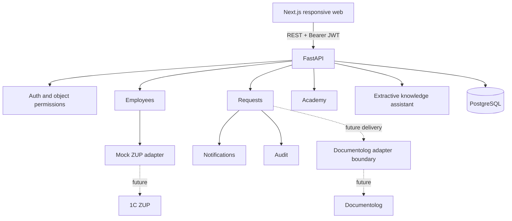

# Архитектура

Frontend получает данные из backend. Кадровые профили загружаются из mock-адаптера seed-командой; запросы пользователя читают сохранённую read-only проекцию. Documentolog представлен границей интерфейса, без заявлений о реальной отправке.

Backend разделён на доменные router/service-модули и общую инфраструктуру. Сессия БД на запрос. Изменение заявки, история, уведомления и аудит входят в одну транзакцию. UPDATE с ожидаемой version защищает решение от гонки. Миграции создают схему явно, без импорта ORM-моделей. create_all на старте не используется.

В MVP уведомления хранятся в той же БД и читаются по HTTP. При внешней доставке потребуется transactional outbox и идемпотентный worker. PostgreSQL + pgvector и генеративный RAG вводятся после оценки качества; текущий помощник использует разрешённые фрагменты демонстрационной базы. Его mode прозрачно указан в API/UI.
