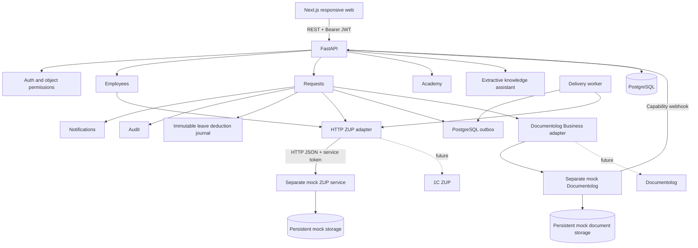

# Архитектура

Основная БД backend, Alembic, тестов и обоих вариантов деплоя — PostgreSQL; `DATABASE_URL` обязателен. SQLite используется только в mock-сервисах. Одиночный web-контейнер подключается к внешнему PostgreSQL, Compose поднимает свой сервис. Автоматического переноса прежней основной SQLite-базы нет.

Frontend получает данные из backend. Кадровые профили впервые загружаются по HTTP из отдельного mock seed-командой; запросы пользователя читают сохранённую read-only проекцию. Актуальный баланс и расчёт запрашиваются из mock по внешнему идентификатору сотрудника. Источник хранит собственные документы и остатки. Backend вычитает из текущего ответа только те локальные списания, ключей которых ещё нет в согласованном списке `applied_commands`. Это устраняет двойной вычет после потери квитанции. Контракт HTTP-расширения — zup-integration.md.

Общий календарь имеет отдельный read-only `/calendar`: для любого вошедшего сотрудника возвращает имена/подразделения всех коллег и активные даты/статусы отпусков за выбранный месяц. Это ограниченная проекция PostgreSQL без вызова ЗУП и без комментариев, истории, остатков коллег и полных профилей. Возможность открыть полную запись вычисляется по прежним объектным правам. Личный календарь использует собственные заявки из `/requests`; решения и кадровые изменения из общего календаря не выполняются.

Documentolog имеет отдельный HTTP mock, собственное хранилище документов и страницу имитации подписания. Явная команда HR после approved сохраняет DOCX и SHA-256 в PostgreSQL; mock скачивает его по capability URL и возвращает сессию по контракту Business. Результат возвращается через capability webhook, отдельно от решения по заявке и учёта отпуска. Миграция 0005 только добавляет таблицу; старые заявки автоматически не отправляются. Создающий API реального Business не обещает идемпотентность, поэтому после начала отправки команда не повторяется автоматически. Настоящие аккаунты/ЭЦП не подключены; ограничения — documentolog-integration.md.

Backend разделён на доменные router/service-модули и общую инфраструктуру. Сессия БД на запрос. Обычная заявка проходит `submitted → manager_approved → approved`; руководитель начинает с этапа `manager_approved` и получает одно финальное решение HR, HR начинает с `submitted` и получает одно финальное решение руководителя. Поле `approval_route` делает маршрут явным в API; самосогласование запрещено. Финальный `rejected` возможен на текущем этапе. Финальное одобрение, запись списания, история, уведомление и аудит входят в одну транзакцию. UPDATE с ожидаемой version и текущим статусом защищает этап от повтора, уникальность `request_id` — от второго списания, а PostgreSQL-блокировка строки сотрудника сериализует одобрения разных заявок по одному балансу. Миграции создают схему явно, без импорта ORM-моделей. create_all на старте не используется.

Команда передачи отпуска создаётся в одной транзакции с финальным решением. Первая попытка выполняется после commit, затем отдельный worker повторяет сохранённую команду с постоянным UUID-ключом; ручной повтор доступен HR. Расчёт и его версия сохраняются в заявке. При недоступности чтения источника нет скрытого fallback; при сбое записи outbox сохраняет pending/error независимо от бизнес-статуса approved.

В MVP уведомления хранятся в той же БД и читаются по HTTP. Их внешняя доставка пока не реализована. PostgreSQL + pgvector и генеративный RAG вводятся после оценки качества; текущий помощник использует разрешённые фрагменты демонстрационной базы. Его mode прозрачно указан в API/UI.
